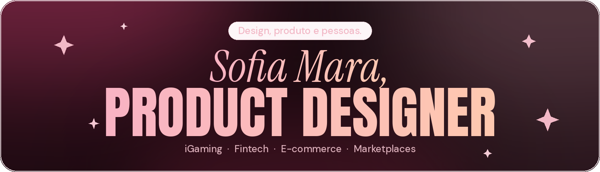
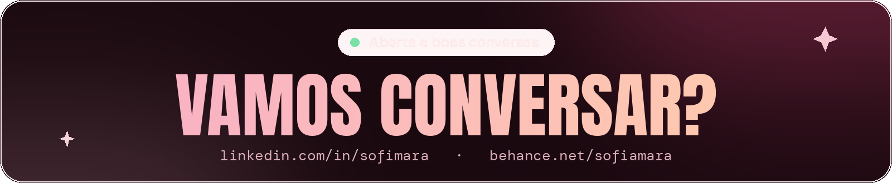

<!-- Banner -->
<p align="center">
  <a href="https://portfolio-sofia-mara.vercel.app/"></a>
</p>

<p align="center">
  
</p>

<p align="center">
  <a href="https://portfolio-sofia-mara.vercel.app/"></a>
  <a href="https://www.linkedin.com/in/sofimara/"></a>
  <a href="https://www.behance.net/sofiamara"></a>
  <a href="mailto:sofiamara09@gmail.com"></a>
</p>


### oi, eu sou a Sofia! 

Sou **Product Designer (UX/UI)** e trabalho com design de produto desde 2021. Transformo problemas complexos em experiências digitais simples, intuitivas e funcionais — conectando necessidades das pessoas, objetivos de negócio e tecnologia.

- ✦ Hoje sou **Product Designer na UX Group**, evoluindo o app mobile de **iGaming** (perfil, gamificação, clubes de fidelidade e desafios)
- ✦ Antes, passei pela **Serasa Experian**, no produto **Premium**
- ✦ Sou **cofundadora do estúdio Solaris**, com projetos de marketplace, fintech e e-commerce
- ✦ São Paulo, Brasil

<br clear="right" />

```js
const sofia = {
  cargo:    "Product Designer (UX/UI)",
  base:     "São Paulo, BR",
  desde:    2021,
  setores:  ["iGaming", "Fintech", "E-commerce", "Marketplaces"],
  faz:      ["Product Discovery", "UX/UI Mobile", "Design System",
             "Gamificação", "Handoff com Engenharia", "Prototipação com IA"],
  mantra:   "da ideia ao impacto ✦",
};
```


### ✦ como eu trabalho

<p align="center">
  
</p>

```
  🔍 descobrir   →   🧩 definir   →   ✏️ desenhar   →   🧪 validar   →   🤝 handoff
  contexto,          problemas,       jornadas,        testes,          fluxos, regras,
  necessidades,      regras de        fluxos e         métricas e       estados e
  pesquisa           negócio          interfaces       feedback         comportamentos
```

Algumas coisas que eu acredito:

> ✦ **boas decisões de design** surgem quando pessoas, negócio e tecnologia são pensados juntos
>
> ✦ **o trabalho não termina numa interface bonita** — precisa fazer sentido pra quem usa e ser viável pra quem constrói
>
> ✦ **design é construído em conjunto** com Produto e Engenharia


### ✦ minha caixinha de ferramentas

**design e prototipação**<br/>


**pesquisa e análise**<br/>


**gestão e colaboração**<br/>


**no código**<br/>


### 🎮 conquistas desbloqueadas

- [x] 5 anos de UX/UI ✨
- [x] cofundou um estúdio de design (Solaris ☀️)
- [x] fez o próprio portfólio no código e publicou na Vercel
- [x] criou um terminal fofinho só pra esse README
- [ ] próximo nível: carregando… `▓▓▓▓▓▓▓░░░`


### ✦ casos selecionados

| caso | o que é |
| --- | --- |
| **Garagem 010** · Marketplace · 2026 | marketplace de caminhões com busca e anúncios numa jornada mais clara → [Behance](https://www.behance.net/gallery/251794497/E-commerce-Garagem010-UIUX-Design) |
| **AJX Capital** · Fintech · 2025 | redesign de experiência de investimento mobile para quem está começando → [Behance](https://www.behance.net/gallery/221381561/Aplicativo-AJX-UIUX-Design) |
| **Gomes da Costa** · E-commerce · 2024 | experiência de compra digital, da descoberta de produtos à decisão → [Behance](https://www.behance.net/gallery/209493775/E-commerce-Gomes-da-Costa-UIUX-Design) |

Todos os detalhes no [**meu portfólio**](https://portfolio-sofia-mara.vercel.app/#casos) ✦ — feito em HTML/CSS e publicado na Vercel.

<br/>

<p align="center">
  <a href="https://www.linkedin.com/in/sofimara/"></a>
</p>
