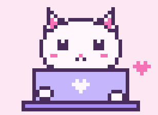
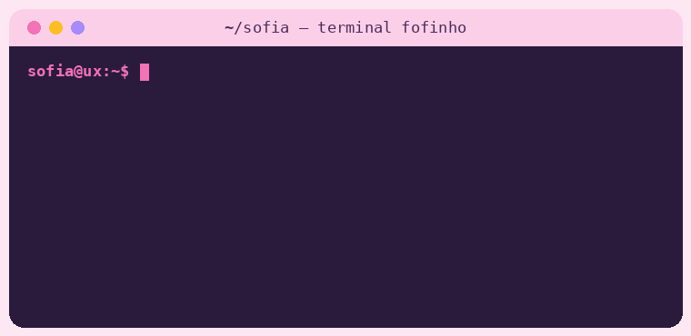

<!-- Banner -->
<p align="center">
  
</p>

<p align="center">
  
</p>

<p align="center">
  <a href="https://www.linkedin.com/in/sofimara/"></a>
  <a href="https://www.behance.net/sofiamara"></a>
  <a href="https://product-design-zee1.vercel.app"></a>
  
</p>




### oi, eu sou a Sofia! 

Sou **Product Designer (UX/UI)** e trabalho com design de produto desde 2021. Gosto de entender gente de verdade antes de abrir o Figma — e de transformar o que descobri em interfaces claras, acessíveis e gostosas de usar.

- 🎰 Hoje sou **Product Designer Pleno na UX Group**, criando produtos de **iGaming**
- 💳 Antes, passei pela **Serasa Experian**, cuidando do produto **Premium**
- ☀️ Sou **cofundadora do estúdio Solaris**, onde faço design desde 2021
- 📍 São Paulo, Brasil

<br clear="right" />

```js
const sofia = {
  cargo:        "Product Designer (UX/UI) · Pleno",
  base:         "São Paulo, BR",
  desde:        2021,
  superpoderes: ["pesquisa", "fluxos", "protótipos", "design systems"],
  stack:        ["Figma", "FigJam", "Miro", "Notion", "HTML", "CSS"],
  mantra:       "clareza > enfeite (mas por que não os dois?) ♡",
};
```


### ♡ como eu trabalho

<p align="center">
  
</p>

```
  🔍 descobrir   →   🧩 definir   →   ✏️ desenhar   →   🧪 testar   →   🔁 iterar
  pesquisa,          problemas,       fluxos,          usabilidade,     ajustar com
  entrevistas,       jornadas,        wireframes,      métricas,        dados e
  dados              hipóteses        protótipos       feedback         carinho ♡
```

Algumas coisas que eu acredito:

> 🌷 **clareza vem antes de beleza** — mas por que não as duas?
>
> 🌷 **acessibilidade não é extra**, é parte do produto
>
> 🌷 **design system é conversa** entre design e dev, não só biblioteca de componentes


### ✦ minha caixinha de ferramentas

<p>
  
  
  
  
  
  
  
  
</p>

**no meu dia a dia:** pesquisa com usuários · testes de usabilidade · arquitetura de informação · fluxos e jornadas · wireframes e protótipos · UI · design systems · handoff com dev

### 🎮 conquistas desbloqueadas

- [x] 5 anos de UX/UI ✨
- [x] cofundou um estúdio de design (Solaris ☀️)
- [x] fez o próprio portfólio no código e publicou na Vercel
- [x] criou um terminal fofinho só pra esse README
- [ ] próximo nível: carregando… `▓▓▓▓▓▓▓░░░`


### ✿ por aqui no GitHub

| projeto | o que é |
| --- | --- |
| 🌸 [**product-design**](https://github.com/SofisMara/product-design) | meu portfólio, feito à mão em HTML/CSS e publicado na Vercel → [ver ao vivo](https://product-design-zee1.vercel.app) |

Sou designer que gosta de entender o código por trás das telas — é aqui que guardo esses experimentos ✨

<p align="center">
  <b>vamos conversar sobre produto, pesquisa ou aquele fluxo que ninguém entende?</b><br/>
  <code>sofia@ux:~$ ./contato --linkedin</code> → <a href="https://www.linkedin.com/in/sofimara/">linkedin.com/in/sofimara</a> ♡
</p>

<p align="center">
  
</p>
